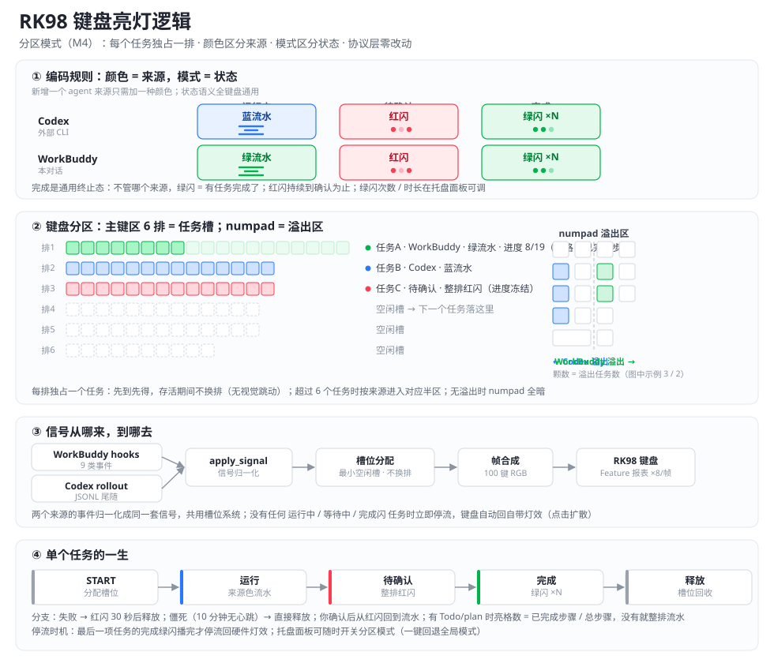

# rk98-keylight

把 WorkBuddy 的运行状态变成 Royal Kludge **RK98** 键盘的灯效。

WorkBuddy 干活时键盘**彩色流水**，需要你拍板时**红灯流水**，一轮回答结束**绿灯闪 3 下**，平时不动键盘、继续用 RK98 自带的灯效（如点击扩散）。

也支持**分区模式**（默认开启）：每个任务独占一排，**颜色区分来源**（Codex 蓝 / WorkBuddy 绿），**模式区分状态**（流水=运行 / 红闪=待确认 / 绿闪=完成），超过 6 个任务进 numpad 溢出区。完整逻辑见图（[docs/lighting-logic.svg](docs/lighting-logic.svg)）：



| 状态 | 触发 | 灯效 |
| --- | --- | --- |
| **运行中** RUNNING | 你发消息 / 工具调用 | 全键盘**彩色流水** |
| **待确认** WAITING | AI 用提问工具问你 | 全键盘**红灯流水** |
| **完成** DONE | 一轮回答结束 | 全键盘**绿灯闪 3 下** → 停流 |
| **平常** IDLE | 空闲 | 停流 → 自动回到键盘自带灯效 |

---

## ⚠️ 先看这里：必须 USB 有线连接

**蓝牙和 2.4G 无线模式下无法控制灯效**，这不是本项目的实现问题，而是协议层面的硬限制。

RK98 的灯效走**厂商私有 HID 集合**（`usage_page 0xFF00`）：

- **USB 有线**：键盘作为完整的 USB 复合设备，暴露 6 个 HID 接口，其中 2 个是 `0xFF00` 灯效接口 → ✅ 可控
- **蓝牙 / 2.4G**：无线链路只暴露标准键盘接口（`usage_page 0x0001`），厂商私有集合不会跨无线传输 → ❌ 不可控

如果万一切到了无线模式，本工具不会静默失效，会在日志里明确告诉你：

```
RK98 在线(接口 0x0001×3, 0x000C×1), 但缺少 0xFF00 灯效接口
—— 这是蓝牙或 2.4G 模式的特征, 请插回 USB 线
```

需要无线 + 状态提示的话，请改用屏幕悬浮窗之类的方案。

---

## 环境要求

- Windows 10/11
- **Python 3.8+**，且**必须带 tkinter**（托盘设置界面需要）
- RK98 用 USB 线连接

### 安装依赖

```bat
pip install hidapi pystray pillow
```

> `hidapi` 是 HID 通信，`pystray` + `pillow` 是托盘图标。
> 注意：官方 Python 安装包默认含 tkinter；Microsoft Store 版也含。精简版/嵌入版 Python 可能没有，
> 那样就只能用控制台模式（见下）。

---

## 快速开始

```bat
start.bat      :: 启动托盘程序（双击也可；已在运行则只打开设置窗口）
stop.bat       :: 停止
```

1. 用 USB 线接上 RK98
2. 双击 `start.bat` → 托盘图标出现在右下角
3. **左键点托盘图标** → 打开设置界面（改颜色/效果/速度/亮度/闪烁次数/开机自启，**保存即热生效，不用重启**）
4. 在 WorkBuddy 里发一条消息试试 → 键盘应该亮起彩色流水

### 只有控制台、没有托盘？

如果你的 Python 没有 tkinter，用无界面模式：

```bat
python src\keylight.py run
```

### 让 WorkBuddy 感知状态（必需）

灯效引擎需要知道 WorkBuddy 在干什么，靠的是它的 hook 机制：

```bat
python src\install_hooks.py install
```

这会向 `~/.workbuddy/settings.json` **追加** 9 个事件的转发命令，**不会动你已有的任何 hook**，并自动备份原文件。

```bat
python src\install_hooks.py uninstall    :: 反向操作，同样先备份
```

### 开机自启

在设置界面里勾选「开机自动启动」即可（写入用户启动文件夹）。

---

## 分区模式：每个任务一排（默认开启）

**颜色 = 来源，模式 = 状态**：

| 来源 | 运行中 | 待确认 | 完成 |
| --- | --- | --- | --- |
| Codex（外部 CLI） | 蓝流水 | 红闪 | 绿闪 ×N |
| WorkBuddy（本对话） | 绿流水 | 红闪 | 绿闪 ×N |

- 主键区 6 排 = 6 个任务槽，**先到先得，存活期间不换排**（不会视觉跳动）；有 Todo/plan 时**亮格数 = 已完成步骤 / 总步骤**，没有就整排流水（不造假进度）
- 需要你拍板时该排**整排红闪**、进度冻结；你确认后回到流水
- 完成时该排**绿闪 ×N**（次数/时长面板可调）后释放；**最后一项播完才停流**，键盘回自带灯效
- 超过 6 个任务 → 按来源进 numpad 溢出区（左半 Codex / 右半 WorkBuddy），**颗数 = 溢出任务数**；无溢出全暗
- 分支：失败 → 红闪 30 秒后释放；僵死（10 分钟无心跳）→ 直接释放

设置界面状态栏有**任务映射表**（排号 / 来源 / 状态 / 进度 / 标签），键盘上看不见的身份在这里查。

### 测试完灯效，怎么把当前任务抓回来？

点完演示按钮或「恢复硬件灯效」之后，真实任务就暂时不在键盘上了。三个入口都能**重新扫描当前任务**（从 WorkBuddy 会话记录 `projects/*/*.jsonl` 恢复 10 分钟内有活动的会话，文件名即 session_id、文件时间即最后活动时间）：

- 托盘右键「**重新扫描当前任务**」
- 设置界面「分区模式」框内的「重新扫描当前任务」按钮
- HTTP：`POST /test {"action":"RESCAN"}`（返回 `{"restored": N}`）

**分区 / 全局双模式随时切换**：托盘右键菜单「切换: 分区(每排一任务) → 全局」（菜单文字随当前模式变化），或设置界面的总开关，或 `POST /test {"action":"TOGGLE_PARTITION"}`。切换后自动按新模式重扫历史，真实任务直接上新模式的键盘显示。

### 想用回「全键盘一个状态」的老模式？

设置界面关掉「分区模式」总开关（或 `config.json` 里 `partition.enabled=false`），行为退回：

**红灯（有人等你拍板）> 彩色流水（有人在干活）> 绿灯闪（全体收工）> 平常**

| 场景 | 显示 |
| --- | --- |
| A、B 两个任务都在跑 | 彩色流水 |
| A 在等你确认，同时 B 在跑工具 | **红灯流水**——红灯优先级更高，不会被抢走 |
| 你回答了 A | 立刻转回彩色流水 |
| A 先完成、B 还在跑 | **不闪绿**（避免误导你以为都做完了） |
| B 也完成了 | 绿灯闪 3 下 → 平常 |
| 某个任务异常残留 | 僵死会话自动清理，通知类信号自动过期，都不会永久卡在红灯 |

---

## Codex 的信号从哪来

分区模式下 Codex 任务也能上排，靠的是**尾随 Codex 的 rollout 会话记录**（`~/.codex/sessions/YYYY/MM/DD/rollout-*.jsonl`），不需要改 Codex 任何配置：

| rollout 事件 | 内部信号 |
| --- | --- |
| `session_meta` / `UserMessage` | 任务开始，分配槽位 |
| `task_started` / `item_completed`（工具调用等） | 心跳，步数活动度 |
| `task_complete` | 任务完成，绿闪释放 |
| `turn_aborted` | 任务失败，红闪 30 秒后释放 |

工程细节：只读文件尾部追加（不补渲染历史）、半行容错、文件删除/轮转自动松脱、`--ephemeral` 模式不落盘则自然无信号。真实事件词汇表由本机样本实测聚合（见 `M4-DESIGN.md` 第 5.2 节）。

> 说明：桌面版 Codex 的审批在 App 内处理、不落盘，所以 **Codex 没有"待确认红闪"信号源**；WorkBuddy 侧的提问工具触发红闪不受影响。

---

## 和 RK98 原生软件的冲突关系

**实测：HID 灯效接口是共享的，原生软件运行时本工具照样能写。**

- RK 软件开着时，本工具写入零失败（5 秒 32 帧实测）——接口不独占
- 两者是"谁最后写谁赢"，但原生软件只在你点「应用」时下发一次灯效，不会持续流式抢写，所以实际不会打架
- 停流时键盘回到硬件里当前存着的灯效——也就是你用原生软件设的效果会正常保留

设置界面有「RK 官方软件抢占 HID 时自动让它退出」开关（默认关，本机实测不需要开）。

---

## 设置界面能改什么

分区与全局效果**二选一**（勾选"分区模式"后，全局效果区自动置灰，反之亦然）：

| 分组 | 项 |
| --- | --- |
| 运行中（仅全局模式） | 效果（RK 官方驱动效果名：流光/流光溢彩/呼吸/常亮/随波逐流/繁星点点/正弦光波）、颜色、速度、帧率、亮度 |
| 待确认（两模式共用） | 颜色、速度、帧率、亮度 |
| 完成（两模式共用） | 颜色、闪烁次数、亮 ms、灭 ms |
| 分区模式（勾选后生效） | 效果（流水/呼吸/繁星点点/随波逐流）、速度、帧率、亮度、来源色 |
| 服务 | 僵死会话清理秒数、RK 官方软件抢占时是否让位、开机自启开关 |
| 按钮 | 保存并应用 / 确认并关闭 / 测试三种效果 / 恢复硬件灯效 |

保存后写入 `config.json` 并热更新正在跑的渲染器，无需重启。

---

## 配置（`config.json`）

| 键 | 默认 | 说明 |
| --- | --- | --- |
| `running.mode` | `flow` | 效果名对齐 RK 官方驱动：`flow` 流光 / `rainbow` 流光溢彩 / `breathe` 呼吸 / `solid` 常亮 / `wave` 随波逐流 / `stars` 繁星点点 / `sine` 正弦光波 |
| `running.color` | `#FF0000` | 单色流水/呼吸用的颜色 |
| `running.fps` / `speed` / `brightness` | 45 / 30 / 100 | 帧率上限 / 波速(列每秒, RK 官方中档≈30) / 亮度(0-100 百分比) |
| `waiting.mode` / `color` | `flow` / `#FF0000` | 待确认：红灯流水 |
| `waiting.brightness` | `100` | 待确认亮度(0-100 百分比) |
| `done.color` / `times` / `on_ms` / `off_ms` | `#00FF00` / 3 / 200 / 120 | 完成绿灯闪烁 |
| `idle.mode` | `hardware` | 平常＝停流，交还自带灯效 |
| `partition.enabled` | `true` | 分区模式总开关（关 = 全局单状态模式） |
| `partition.effect` | `flow` | 分区运行中效果：`flow` 流水 / `breathe` 呼吸 / `stars` 繁星点点 / `wave` 随波逐流（排间错峰） |
| `partition.speed` / `fps` / `brightness` | 30 / 45 / 100 | 与全局同规格（波速 / 帧率 / 亮度 0-100） |
| `partition.breathe_period` | `2.0` | 分区呼吸效果周期（秒） |
| `partition.waiting_on_ms` / `waiting_off_ms` | 150 / 100 | 待确认红闪的亮/灭时长 |
| `partition.fail_flash_secs` | `30` | 任务失败红闪多久后释放 |
| `partition.tail` | `8` | 排内流水波尾宽度（格） |
| `sources.workbuddy.color` | `#00E676` | 分区模式：WorkBuddy 运行色 |
| `sources.codex.color` | `#2979FF` | 分区模式：Codex 运行色 |
| `codex.enabled` / `sessions_dir` / `poll_secs` | `true` / `~/.codex/sessions` / 2 | Codex rollout 尾随开关、目录、轮询间隔 |
| `device.vid` / `pid` | `258A` / `00C1` | 目标设备（其他型号可改） |
| `conflict.close_rk_app` | `false` | 是否自动结束 RK 官方软件 |
| `service.port` | `18990` | 本地事件端口（hook 转发器会读这个值） |
| `service.stale_session_secs` | `600` | 会话多久没心跳算僵死 |
| `service.notice_secs` | `20` | 通知类等待信号的有效期 |
| `source.tail_hook_events` | `false` | 是否额外尾随外部事件文件 |
| `source.hook_events_path` | `""` | 外部事件文件路径（尾随开启时填） |
| `source.projects_root` | `""` | 重新扫描的会话记录根目录（留空 = 从 hook 事件的 transcript_path 自动推导） |

> 亮度统一为 0-100 百分比量表（默认 100＝全亮）；2026-10-14 之前的 0-1 浮点配置会在加载时自动迁移（×100）。
>
> 实测帧率约 12fps（受 USB Feature 报表往返限制，非配置问题），流水/闪烁观感不受影响。

---

## 手动调试

```bat
:: 状态与统计
curl http://127.0.0.1:18990/status

:: 手动触发某状态（不经事件）—— 建议先关掉 hook 干扰
curl -X POST http://127.0.0.1:18990/test -d "{\"state\":\"DONE\"}"     :: 绿灯闪
curl -X POST http://127.0.0.1:18990/test -d "{\"state\":\"WAITING\"}" :: 红灯流水
curl -X POST http://127.0.0.1:18990/test -d "{\"state\":\"RUNNING\"}" :: 彩色流水
curl -X POST http://127.0.0.1:18990/test -d "{\"state\":\"IDLE\"}"     :: 交还自带灯效
curl -X POST http://127.0.0.1:18990/test -d "{\"state\":\"UI\"}"       :: 弹出设置窗口

:: 分区演示（不依赖真实 agent；托盘设置窗也有同名按钮）
curl -X POST http://127.0.0.1:18990/test -d "{\"action\":\"DEMO\"}"          :: 3 个假任务跑一轮
curl -X POST http://127.0.0.1:18990/test -d "{\"action\":\"DEMO_OVERFLOW\"}"  :: 10 个任务看溢出区

:: 重新扫描当前任务 / 切换分区-全局双模式
curl -X POST http://127.0.0.1:18990/test -d "{\"action\":\"RESCAN\"}"            :: 恢复真实在跑的任务
curl -X POST http://127.0.0.1:18990/test -d "{\"action\":\"TOGGLE_PARTITION\"}"  :: 分区/全局互切

:: 单次状态试跑（不常驻）
python src\keylight.py test --state RUNNING --secs 6

:: 设备诊断
python src\verify_m1.py enumerate          :: 枚举 HID 接口
python src\diag_caps.py                    :: 查接口能力（报表 ID/长度）
```

状态写在 `status.json`，日志在 `keylight.log`。

---

## 目录结构

```
rk98-keylight/
├── config.json          配置（设置界面与手改共用）
├── start.bat / stop.bat 启动 / 停止
├── requirements.txt     依赖
├── M4-DESIGN.md         分区模式设计文档（含硬件实测记录）
├── docs/
│   └── lighting-logic.svg  亮灯逻辑图示
├── src/
│   ├── tray.py          ★ 托盘程序 + 设置界面（主入口）
│   ├── keylight.py      常驻服务（状态机 + HTTP + 会话清理）
│   ├── rk98.py          HID 驱动（Feature 报表协议）
│   ├── effects.py       灯效帧生成（流水/呼吸/闪烁，全局 + 排级）
│   ├── keymap.py        100 键 → 帧缓冲映射 + 分区常量（ROWS/NUMPAD）
│   ├── partition.py     分区帧合成器（任务表 + 槽位分配 + 溢出区）
│   ├── codex_tail.py    Codex rollout JSONL 尾随
│   ├── hook.py          hook 转发器（stdin→POST，永远 exit 0）
│   ├── install_hooks.py hook 注册/卸载
│   ├── verify_m1.py     物理验证脚本
│   └── diag_*.py        HID 能力诊断脚本
├── tests/               离线单元测试（无需键盘，33 用例：分区/尾随/重扫描）
└── probes/              hw_probe.py（协议能力探针）
```

---

## 协议笔记（改灯效前建议先读）

这部分是本项目能跑起来的关键，也是大多数人踩坑的地方：

1. **接口**：设备 `VID 258A / PID 00C1`，灯效接口是 `MI_01 & Col05`（`usage_page 0xFF00`）。同一台键盘还有 `Col03` 也是 `0xFF00`，`Col05` 优先。

2. **命令走 Feature 报表，不是 Output 报表**——这是最大的坑。
   ReportID `0x0A`，总长 **65 字节**（1 字节 ID + 64 字节负载）。
   用 `hidapi.write()` 发 Output 报表会被 **Windows 静默丢弃**：不报错、返回成功，但键盘毫无反应。
   必须用 `dev.send_feature_report()`。

3. **每帧 8 个报表**：
   - `init`：zone 1
   - `stream`：zone 2..6（每个 62 字节负载）
   - `commit`：zone 6、7（零填充）
   每个报表之间 sleep 1ms。

4. **停流即回硬件灯效**：停止发送后键盘自动回到硬件灯效，所以 IDLE 状态什么都不用发。

5. **逐键 RGB 索引**：见 `src/keymap.py` 的 `VKEYS`，按 37×11 网格的奇数偏移排列。

如果你的键盘型号不同（VID/PID 或网格布局不同），大概率只需要改 `device.vid`/`device.pid`、`preferred_collection` 和 `keymap.py`。

---

## 可能遇到的问题

| 现象 | 原因 / 解决 |
| --- | --- |
| 写入成功但键盘没反应 | 用了 Output 报表 → 必须改用 Feature 报表（见协议笔记第 2 条） |
| 找不到灯效接口 | 切到蓝牙/2.4G 了 → 插回 USB 线 |
| 绿灯不闪 | 事件源没注册 → 跑 `install_hooks.py install`；或用 `/test` 手动验证灯效本身 |
| 提示端口被占用 | 已有实例在跑 → 双击 `start.bat` 会自动只弹设置窗口；或先 `stop.bat` |
| 双实例抢键盘 | 启动前会探端口，占用即拒绝启动，不会出现 |
| 托盘不出现 | Python 缺 tkinter → 用 `python src\keylight.py run` 控制台模式 |

---

## 致谢

- 灯效协议参考了 SignalRGB 的开源插件
  [SRGB_RK98-100KRGB-N-Keyboard](https://github.com/EasySharp/SRGB_RK98-100KRGB-N-Keyboard)（MIT），
  本项目未直接引入其代码，而是独立实现并补充了 Windows 下 Feature 报表发送、状态机、托盘 UI 等部分。
- 状态来源思路参考了 [workbuddy-switch](https://github.com/changexbc/workbuddy-switch) 与其
  [agent-companion](https://github.com/changexbc/agent-companion) 的 hook 采集方式。

## License

MIT，见 [LICENSE](LICENSE)。